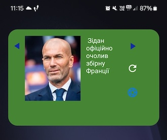
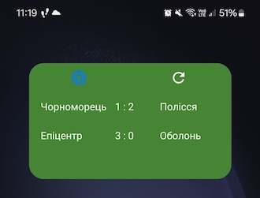
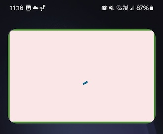
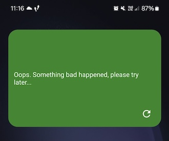

# Football-news

Football-news is a widget-magazine that brings you the latest news from Ukrainian and world football. 
With the Football-news widget on your home screen, you're always up to date — no need to open an app.

The widget has two main tabs:
- **News** — scroll through the latest football headlines
- **Live** — follow live scores for top matches as they happen

## Screenshots

  
  
  
  

## Architecture

Football-news is a multi-module Android project centered around the home-screen widget experience:

- **`:app`** — Android application module. Owns the widget system, DI wiring, and view-layer rendering (`IRemoteViewRenderer` implementations, WorkManager sync jobs).
- **`:shared-domain`** — Kotlin Multiplatform module (Android + iOS targets) containing the platform-agnostic domain, data, and networking layer, built on Ktor.

See [`CLAUDE.md`](CLAUDE.md) for a detailed breakdown of module responsibilities, dependency injection setup, and data flow.
